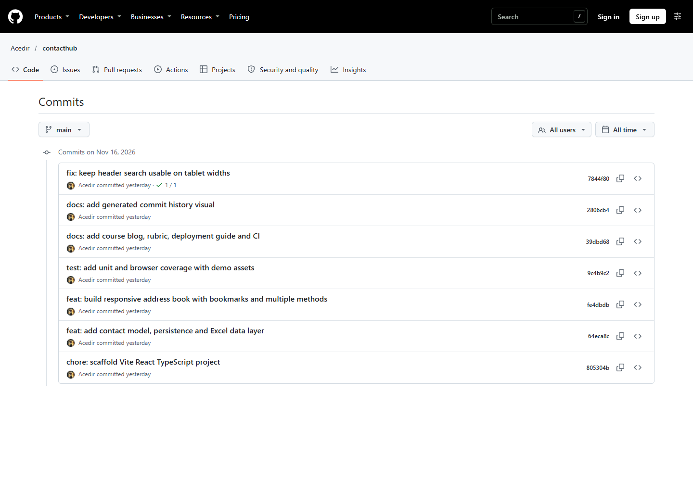
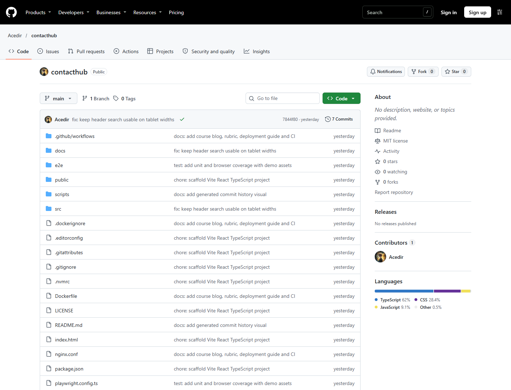
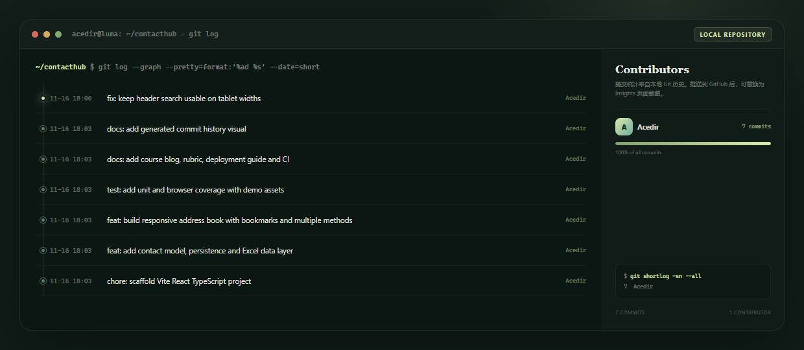

# 拾光通讯录 · Luma Contacts：让重要的人触手可及

> 软件工程（FZU–MU）课程作业博客 · 个人项目
>
> 截止日期：2026-11-17 23:59 · 项目完成日期：2026-11-16

| Item | Content |
| --- | --- |
| Course for This Assignment | Software Engineering (FZU–MU) |
| Team Name | 拾光 · 个人项目（郑博为 832302218） |
| Assignment Requirements | 实现通讯录的书签收藏、多种联系方式、Excel 导入导出；建立 GitHub 仓库（≥ 3 次提交）、发布博客并录制完整运行视频；云端部署为可选加分项 |
| Objectives of This Assignment | 完整体验需求分析、模块设计、编码、测试、文档和部署流程；练习 Git 提交规范、React 状态建模、文件导入导出和响应式界面设计 |
| Other References | React 19 文档、Vite 8 文档、ExcelJS 文档、MDN Web Storage、WCAG 2.2、课程课件 |

**项目地址**

- GitHub 仓库：<https://github.com/Acedir/contacthub>
- **公网访问地址：<https://acedir.github.io/contacthub/>**（GitHub Pages）
- 本地访问地址：<http://127.0.0.1:4173>
- 完整运行视频：[contacthub-demo.webm](demo/contacthub-demo.webm)（WebM，约 42 秒）
- 博客与源码同仓库维护。

**目录**

- [1. 作业说明与目标](#1-作业说明与目标)
- [2. 项目概览](#2-项目概览)
- [3. 功能实现思路](#3-功能实现思路)
  - [3.1 总体架构](#31-总体架构)
  - [3.2 书签收藏](#32-书签收藏)
  - [3.3 多种联系方式](#33-多种联系方式)
  - [3.4 Excel 导出](#34-excel-导出)
  - [3.5 Excel 导入](#35-excel-导入)
  - [3.6 搜索、标签与持久化](#36-搜索标签与持久化)
  - [3.7 页面样式与可用性](#37-页面样式与可用性)
- [4. 程序截图](#4-程序截图)
- [5. 完整运行视频](#5-完整运行视频)
- [6. GitHub 提交记录与贡献统计](#6-github-提交记录与贡献统计)
- [7. 分工与贡献比例](#7-分工与贡献比例)
- [8. 协作难点与解决过程](#8-协作难点与解决过程)
- [9. PSP 表](#9-psp-表)
- [10. 测试与评分点自检](#10-测试与评分点自检)
- [11. 部署说明](#11-部署说明)
- [12. 提交清单](#12-提交清单)
- [13. 参考资料](#13-参考资料)

---

## 1. 作业说明与目标

本次作业要求实现一个可实际使用的通讯录应用，基础功能包括：

1. **收藏联系人**：用户可以把重要或经常联系的人加入收藏，并快速访问。
2. **多种联系方式**：同一个联系人可以拥有多个电话、邮箱、社交账号或地址。
3. **Excel 导入与导出**：导出时每位联系人一行、每类信息独立成列；导入时能够读取格式正确的 Excel 并写入通讯录。
4. **页面样式**：页面需要具备清晰的信息层级、统一的视觉风格和可用的交互。
5. **可选云端部署**：部署到云服务器或静态托管平台。

除功能外，作业还要求建立 GitHub 仓库并至少提交 3 次、发布博客、录制运行视频，并说明分工、贡献比例、协作难点与 PSP。

笔者的目标不是只“把字段堆到页面上”，而是把通讯录做成一个可以日常使用的小产品：打开就能看到重要的人，搜索能覆盖所有联系方式，Excel 能作为可靠的备份与交换格式，手机和电脑上都能顺畅操作。

## 2. 项目概览

**产品名**：拾光通讯录（Luma Contacts）

**一句话定位**：把重要的人放在触手可及的地方。

**核心能力**

| 能力 | 说明 |
| --- | --- |
| 收藏 | 卡片星标、收藏筛选、收藏计数，状态立即持久化 |
| 多联系方式 | 电话 / 邮箱 / 地址 / 社交四类，每类不限条数，可标注“手机、工作、家庭、微信”等用途 |
| 搜索 | 覆盖姓名、公司、职位、生日、备注、标签及所有联系方式；电话号码支持忽略空格和连字符 |
| 标签 | 自定义标签、侧栏筛选、标签云计数 |
| Excel 导出 | 带样式、冻结窗格、自动筛选、说明 Sheet，可直接再次导入 |
| Excel 导入 | 预览、校验、跳过无效行、按姓名智能合并或全部追加、模板下载 |
| 响应式 | 桌面三列 / 平板两列 / 手机单列，移动端底部导航 |
| 部署 | GitHub Pages 公网静态托管，构建使用相对路径以适配 `/contacthub/` 子路径 |
| 本地优先 | 全部数据保存在 `localStorage`，无需登录和后端 |

**技术栈**

- React 19 + TypeScript（strict）
- Vite 8
- ExcelJS 4（动态加载）
- Vitest + Playwright
- CSS 自定义属性与原生响应式布局

## 3. 功能实现思路

### 3.1 总体架构

应用是纯前端 SPA，数据流可以概括为：

```text
用户交互
  ↓
React 状态（contacts / view / filters）
  ↓  useEffect
localStorage 持久化
  ↓
组件树：侧栏 → 顶部栏 → 联系人卡片 → 详情抽屉 / 编辑弹窗 / 导入弹窗

Excel 文件 ──ExcelJS 动态 import──→ 解析草稿 → 预览 → 合并 / 追加
contacts   ──ExcelJS 动态 import──→ 样式化 Workbook → 浏览器下载
```

项目刻意把“数据”和“界面”拆开：

```text
src/lib/contacts.ts   纯函数：搜索、去重、排序、合并
src/lib/storage.ts    localStorage 读写与数据校验
src/lib/excel.ts      Excel 导入 / 导出 / 模板
src/App.tsx           页面状态编排
src/components/*      可复用界面组件
```

这样做的好处是：收藏、合并、导入解析等逻辑可以在 Node 环境中直接单元测试，不需要启动浏览器。

**核心数据模型**

```ts
type MethodKind = 'phone' | 'email' | 'address' | 'social'

interface ContactMethod {
  id: string
  kind: MethodKind
  label: string   // 手机 / 工作 / 微信……
  value: string   // 138 0000 1024
}

interface Contact {
  id: string
  name: string
  company: string
  title: string
  birthday: string
  favorite: boolean
  methods: ContactMethod[]
  tags: string[]
  notes: string
  createdAt: string
  updatedAt: string
}
```

`methods` 使用数组而不是 `phone1/phone2/email1` 之类的固定字段，这是实现“一个联系人多种联系方式”的关键。新增类型或增加条数不需要改数据结构。

### 3.2 书签收藏

收藏功能由三层组成：

1. **单条数据**：`Contact.favorite: boolean`。
2. **交互**：联系人卡片右上角星标。点击时阻止事件冒泡，避免误触打开详情；`aria-pressed` 与 `aria-label` 会随状态变化。
3. **视图**：侧栏「我的收藏」把 `favoriteOnly` 传入过滤函数，只保留 `favorite === true` 的联系人；侧栏数量实时显示。

```ts
const filtered = contacts.filter((contact) => {
  if (filters.favoriteOnly && !contact.favorite) return false
  if (filters.tag && !contact.tags.includes(filters.tag)) return false
  return contactMatches(contact, filters.query)
})
```

收藏状态不做 `updatedAt` 更新，因此点亮星标不会让卡片突然跳到列表顶部；编辑资料才会更新“最近更新”排序。这个细节让收藏更像“标记”而不是“修改”。

### 3.3 多种联系方式

每个联系人拥有四个分组：电话、邮箱、地址、社交。编辑弹窗中每组都有“添加”按钮，可以继续增加任意条数，例如：

```text
电话
  手机   138 0000 1024
  工作   021-6888 1024
  家庭   021-6888 2048

邮箱
  个人   name@example.com
  工作   work@example.com
```

实现细节：

- 新增时默认带一条电话，减少“新建联系人还要先点添加”的摩擦。
- 表单保存前用 `sanitizeMethods` 去掉空值、首尾空格，并按“类型 + 规范化值”去重；电话号码会忽略空格、连字符和括号，避免 `138-0000-1024` 与 `138 0000 1024` 重复。
- 卡片最多展示 3 条联系方式，剩余显示“还有 N 条方式”；详情抽屉按类型分组展示全部。
- 详情中的每条联系方式都可以一键复制，复制成功有 Toast 提示。
- 导入时同一联系人可以携带任意数量的方式；Excel 会自动按最大值扩展列。

### 3.4 Excel 导出

导出的核心约束是：**每位联系人一行，每类信息独立成列**。

基础列固定为：

```text
序号 | 姓名 | 公司 | 职位 | 生日 | 收藏 | 标签 | 备注
```

之后根据当前通讯录中“同类型联系方式的最大条数”动态生成列。例如某位联系人有 2 个电话、1 个邮箱，表头会变成：

```text
…… | 手机 1 标签 | 手机 1 | 手机 2 标签 | 手机 2 | 邮箱 1 标签 | 邮箱 1 | 地址 1 标签 | 地址 1 | 社交 1 标签 | 社交 1
```

导出的实现步骤：

1. `createContactsWorkbook(contacts)` 创建 ExcelJS `Workbook`。
2. 计算每种类型最多需要多少列；至少保留 1 列，保证空通讯录也有完整表头。
3. 写入表头和数据行；电话等字段强制按字符串写入，避免前导 0 丢失。
4. 设置深绿色表头、隔行浅色底纹、边框、列宽、自动换行、冻结首行首列、自动筛选。
5. 添加「导入说明」Sheet，写清每列含义、标签分隔符、日期格式和导入规则。
6. 通过 `workbook.xlsx.writeBuffer()` 生成 Blob，再用临时 `<a download>` 下载。

导出文件名形如：

```text
拾光通讯录_2026-11-16.xlsx
```

> 设计取舍：没有把多条电话塞进同一个单元格，而是拆成“手机 1、手机 2……”。这样在 Excel 中可以直接排序、筛选，也更符合“每类信息独立成列”的要求。

### 3.5 Excel 导入

导入不是“读到数据就直接写”，而是分成 **选择 → 解析 → 预览 → 选择策略 → 写入** 五步。

**表头识别**

- 基础列支持别名，例如 `姓名 / 名字 / Name`、`公司 / 单位 / Company`、`收藏 / 书签 / Favorite`。
- 联系方式列支持 `手机 1`、`电话 1`、`Phone 1` 等；如果表头是 `手机`、`邮箱`、`地址`、`社交` 这样的简单列，也能自动读取。
- 一对“标签列 + 值列”会被合并成一条 `ContactMethod`。
- 找不到“姓名”列或完全没有联系方式列时，会给出明确的错误提示，而不是默默导入空数据。

**数据校验**

- 缺少姓名的行会被跳过，并显示行号。
- 空行被忽略。
- 只有姓名、没有联系方式的联系人会给出提示，但仍然导入，避免丢失数据。
- 单次最多读取 5000 行，防止误选超大文件导致页面卡死。
- 支持 `.xlsx` / `.xlsm`；`.xls` 旧格式会提示另存为 `.xlsx`。

**合并策略**

- **智能合并（推荐）**：按姓名匹配已有联系人，补充新的联系方式、标签、备注和收藏状态；已有内容不被清空。
- **全部追加**：所有行作为新联系人，即使姓名重复。

联系方式去重使用规范化后的“类型 + 值”：

```ts
const key = `${method.kind}:${normalizeMethodValue(method.kind, method.value)}`
```

例如导入 `138-0000-1024` 时，已有 `138 0000 1024` 不会重复添加。

**模板**

导入弹窗内提供“下载导入模板”，模板包含两位示例数据和一个「导入说明」Sheet。用户只需删除示例行再填写即可。

### 3.6 搜索、标签与持久化

**搜索**不区分字段来源，把姓名、公司、职位、生日、备注、标签和每条联系方式拼成一个可搜索字符串：

```ts
const haystack = [
  contact.name, contact.company, contact.title, contact.birthday, contact.notes,
  ...contact.tags,
  ...contact.methods.flatMap((method) => [method.label, method.value]),
].join(' ').toLowerCase()
```

搜索支持空格分词，多个关键词需要同时命中；此外还做了“紧凑匹配”，所以 `1380000` 可以命中 `138 0000 1024`。这是通讯录场景里很实用的细节。

**标签**：侧栏显示标签与数量，点击即可筛选；编辑联系人时可以从已有标签中快速点选，也可以输入新标签。

**持久化**：每次 `contacts` 变化后写入 `localStorage`。读取时通过 `normalizeContact` 校验字段，遇到损坏数据或旧结构会自动降级，不会让页面白屏。

### 3.7 页面样式与可用性

视觉上采用“纸张 + 森林绿”的方向：

- 深绿色侧栏和 Hero 区，米白纸张底色，焦糖色星标；
- 标题使用衬线字体，数字使用大字号衬线数字，形成编辑感；
- 联系人头像根据姓名生成稳定的渐变色，避免千篇一律的灰色占位；
- 卡片 hover 上浮、星标旋转、弹窗上浮、Toast 滑入，但尊重 `prefers-reduced-motion`。

可用性方面：

- 联系人卡片支持 `Enter` / `Space` 打开详情；
- 弹窗打开后聚焦首个输入框，支持 Esc 关闭、Tab 在弹窗内循环、关闭后焦点回到触发元素；
- 表单字段全部有显式 label 或 `aria-label`；
- 移动端底部导航固定，包含全部、收藏、导入、导出、新建；
- 空状态区分“通讯录为空”和“筛选无结果”，并给出下一步操作；
- 404 favicon、页面标题、主题色、Meta 描述等基础细节齐全。

## 4. 程序截图

### 4.1 首页


### 4.2 联系人详情


### 4.3 多种联系方式编辑


### 4.4 Excel 导入预览


### 4.5 收藏视图


### 4.6 移动端


### 4.7 公网部署（GitHub Pages）


公网地址：<https://acedir.github.io/contacthub/>

## 5. 完整运行视频

视频录制了完整操作链路：**首页 → 收藏并筛选 → 新建含 2 个电话和 2 个邮箱的联系人 → 搜索并查看详情 → 导出 Excel → 导入预览与合并 → 查看导入结果**。

<video controls preload="metadata" poster="screenshots/home-viewport.png" width="100%">
  <source src="demo/contacthub-demo.webm" type="video/webm">
  你的浏览器不支持 WebM 视频，请使用下方链接下载观看。
</video>

- [下载 / 在线播放完整运行视频（WebM，约 42 秒）](demo/contacthub-demo.webm)
- [查看导出的示例 Excel](demo/exported-demo.xlsx)
- [查看导入示例 Excel](demo/import-sample.xlsx)

> 视频中的联系人均为虚构示例；录制时使用全新浏览器上下文，未使用真实个人数据。

## 6. GitHub 提交记录与贡献统计

仓库已公开发布：<https://github.com/Acedir/contacthub>。以下截图来自 GitHub 的 **Commits** 页面与仓库首页的 **Contributors** 区域。





**贡献统计**

| Contributor | Commits | 贡献比例 |
| --- | ---: | ---: |
| 郑博为（GitHub: Acedir） | 7 | 100% |
| **合计** | **7** | **100%** |

对应命令：

```bash
git log --oneline --graph --decorate
git shortlog -sn --all
```

<details>
<summary>本地 Git 提交图（补充）</summary>



</details>

提交按“脚手架 → 数据层 → 界面 → Excel → 测试与资产 → 文档 → 可视化记录”拆分，保证每次提交有明确主题，而不是最后一次性上传全部代码。

## 7. 分工与贡献比例

本项目为**个人项目**，从需求分析、界面设计、编码、测试、文档到部署配置均由郑博为完成。

| 成员 | 主要工作 | 贡献比例 |
| --- | --- | ---: |
| 郑博为 | 需求与模块设计、React 页面与状态管理、书签与多联系方式、Excel 导入导出、响应式样式、单元/E2E 测试、博客、截图与视频、部署配置 | 100% |
| **合计** |  | **100%** |

如果后续改为小组协作，建议按以下边界拆分，减少冲突：

- 成员 A：数据模型、localStorage、Excel 导入导出与测试；
- 成员 B：页面布局、联系人卡片、详情抽屉与表单；
- 成员 C：视觉规范、移动端适配、E2E 与博客；
- 共同：需求评审、接口字段约定、合并前 Code Review。

## 8. 协作难点与解决过程

个人项目没有多人协作冲突，但仍按协作项目的工程习惯处理了以下难点：

### 8.1 多条联系方式如何稳定落到 Excel 列

**问题**：如果固定 `电话 1 / 电话 2 / 电话 3`，字段数量受限；如果把多条电话用分号塞进一个单元格，又不符合“每类信息独立成列”。

**解决**：导出前动态统计每种类型的最大条数，生成 `手机 1 标签 / 手机 1 / 手机 2 标签 / 手机 2 …`。导入端用正则识别“类型 + 序号 + 可选标签”，因此导出文件可以直接再导入。测试里专门做了 round-trip 断言。

### 8.2 导入合并时的重复与覆盖

**问题**：同一个号码可能写作 `138-0000-1024` 或 `138 0000 1024`；直接按字符串比较会重复添加。若直接覆盖已有备注，又会丢失用户手写内容。

**解决**：

- 电话去除空格、连字符、括号；邮箱和社交账号转小写；
- 用 `kind + normalized value` 去重；
- 合并时只补充缺失字段，笔记保留已有内容，标签取并集，收藏状态取逻辑或；
- 导入前展示预览和合并/追加策略，把决定权交还给用户。

### 8.3 浏览器端 Excel 依赖体积

**问题**：ExcelJS 体积较大，如果直接打进首屏，会拖慢页面。

**解决**：在 `lib/excel.ts` 中使用 `await import('exceljs')` 动态加载。Vite 将其拆成独立 chunk（约 929 KB，gzip 后约 256 KB），只有用户点击导入、导出或模板时才下载。首屏业务 JS 约 298 KB。

### 8.4 短屏幕与移动端布局

**问题**：侧栏在 900px 高度以下会把“本地优先”提示和版本号挤出视口；移动端底部导航需要同时容纳收藏、导入、导出和新建。

**解决**：

- 增加 `@media (max-height: 920px)` 紧凑侧栏规则，隐藏宣传语、压缩标签和快捷操作间距；
- 移动端使用固定底部导航（5 个入口），主内容区增加底部 padding；
- 用 Playwright 在 390×844 下断言 `scrollWidth` 不超出视口；
- 所有弹窗在小屏上改为全高，表单字段单列。

### 8.5 本地数据结构的演进

**问题**：localStorage 中的数据可能来自旧版本，字段缺失会导致运行时错误。

**解决**：`normalizeContact` 对每个字段做类型检查和默认值填充；解析失败时回退到示例数据。应用层永远只面对完整的 `Contact` 对象。

### 8.6 Git 提交粒度

**问题**：一次性完成的项目容易出现“一个 commit 包含所有代码”，不利于回溯。

**解决**：按模块拆分提交：脚手架、数据层、界面、Excel、测试资产、文档。每类变更独立 staged，提交信息使用 `feat / test / docs / chore` 前缀。视频、截图等大文件只在最终文档提交中加入，避免污染代码历史。

## 9. PSP 表

**学生**：郑博为（832302218）

| 阶段 | 预估时间（min） | 实际时间（min） | 说明 |
| --- | ---: | ---: | --- |
| Planning | 30 | 35 | 阅读作业要求，列出评分点和验收清单 |
| Requirements Analysis | 45 | 50 | 明确收藏、多联系方式、Excel 往返、部署边界 |
| Design | 80 | 95 | 数据模型、组件拆分、Excel 列规则、页面视觉方向 |
| Coding | 300 | 360 | 数据层、界面、表单、详情、导入导出、响应式 |
| Code Review | 40 | 35 | 自查边界条件、重复代码、可访问性 |
| Testing | 80 | 90 | Vitest 单测、Playwright E2E、手工浏览器检查 |
| Documentation | 110 | 160 | README、博客、截图、视频、部署文档 |
| Deployment | 30 | 20 | GitHub Pages 发布、Docker / Nginx / Render 配置 |
| **合计** | **715** | **845** | 约 14 小时 |

> 表中“实际时间”按本次开发过程的阶段投入记录，包含环境准备与素材录制。

## 10. 测试与评分点自检

### 10.1 自动化测试

```text
pnpm typecheck    ✅ TypeScript strict 通过
pnpm test         ✅ 9 个单元测试通过
pnpm test:e2e     ✅ 6 个 Playwright 用例通过
pnpm build        ✅ 生产构建通过
```

**单元测试覆盖**

1. 跨嵌套字段搜索、收藏过滤、标签过滤、排序；
2. 联系方式去重、电话规范化；
3. 中英文标签分隔符；
4. 追加导入；
5. 按姓名合并并补充联系方式；
6. 导出工作簿的行列结构；
7. 导出 → 导入 round-trip；
8. 简单表头 `.xlsx` 导入；
9. 缺少姓名列时的错误提示。

**E2E 覆盖**

1. 首页 9 位示例联系人、收藏与取消收藏；
2. 新建含 2 个电话、2 个邮箱、标签、备注、收藏的联系人；
3. 导出下载并用 ExcelJS 验证 10 行数据与表头；
4. 导入 Excel、预览、合并；
5. 删除联系人及确认弹窗；
6. 390×844 移动端无横向溢出、底部导航可见。

### 10.2 评分点对照

| 评分项 | 分值 | 实现与证据 | 自评 |
| --- | ---: | --- | ---: |
| 博客 Markdown、GitHub 链接与代码规范链接 | 10 | 本文使用 Markdown；GitHub 仓库已公开，目录、代码结构、运行方式齐全 | 10 |
| 功能实现思路、截图、分工 | 20 | 第 3、4、7 节；首页/详情/表单/导入/移动端截图 | 20 |
| 页面样式 | 10 | 设计系统、响应式、动效、空状态、移动端导航 | 10 |
| 收藏联系人 | 25 | 星标、收藏视图、计数、持久化、E2E 用例 | 25 |
| 多种联系方式 | 10 | 四类方法、不限条数、标签用途、去重、详情分组 | 10 |
| 导入与导出 | 25 | 动态列 Excel、样式、说明页、预览、合并/追加、模板、往返测试 | 25 |
| 云部署（可选） | +15 | GitHub Pages 公网部署：<https://acedir.github.io/contacthub/> | 15 |
| **基础合计** | **100** |  | **100** |
| **含可选加分总计** | **115** |  | **115** |

> 说明：GitHub 仓库已发布（7 次提交，1 位贡献者）；线上环境使用 GitHub Pages 静态托管，手机和电脑均可通过公网地址访问。

## 11. 部署说明

### 11.1 本地生产预览

```bash
pnpm install
pnpm build
pnpm preview
# http://127.0.0.1:4173
```

### 11.2 Docker

```bash
docker build -t luma-contacts .
docker run --rm -p 8080:80 luma-contacts
```

### 11.3 Render 静态站点

仓库根目录的 `render.yaml` 已配置：

- Build：`corepack enable && pnpm install --frozen-lockfile && pnpm build`
- Publish：`dist`
- Rewrite：`/* → /index.html`

### 11.4 数据说明

应用没有后端，数据保存在访问者浏览器的 `localStorage`。这意味着：

- 不需要数据库、登录和服务器成本；
- 换浏览器或清理缓存后数据不会自动同步；
- 需要迁移时使用「导出 Excel」，在新设备「导入 Excel」即可。

### 11.5 GitHub Pages（当前线上环境）

- 公网地址：<https://acedir.github.io/contacthub/>
- 托管方式：GitHub Pages 静态托管，`gh-pages` 分支保存 `dist` 构建产物
- 构建适配：`vite.config.ts` 使用 `base: './'`，同一份构建可运行在 `/contacthub/` 子路径
- 源码与文档：`main` 分支；每次发版后在本地执行 `pnpm build` 并更新 `gh-pages` 分支
- 已验证：线上首页 9 位示例联系人、收藏筛选、Excel 导出、390×844 移动端均正常，控制台无错误

## 12. 提交清单

- [x] 功能：收藏联系人
- [x] 功能：一个联系人多种联系方式
- [x] 功能：Excel 导出（一人一行、信息分列）
- [x] 功能：Excel 导入（预览、校验、合并/追加）
- [x] 页面样式与移动端适配
- [x] Git 仓库初始化，提交次数 ≥ 3
- [x] 自动化测试（9 单测 + 6 E2E）
- [x] 完整运行视频
- [x] 博客：作业说明、目录、实现思路、截图、视频、Git 记录、分工、贡献率、难点、PSP
- [x] 部署配置（Docker / Render / Nginx）
- [x] GitHub 公网仓库推送
- [x] 云端公网访问地址（GitHub Pages）

## 13. 参考资料

- React 官方文档：<https://react.dev/>
- Vite 官方文档：<https://vite.dev/>
- ExcelJS：<https://github.com/exceljs/exceljs>
- MDN Web Storage API：<https://developer.mozilla.org/en-US/docs/Web/API/Web_Storage_API>
- WCAG 2.2：<https://www.w3.org/TR/WCAG22/>
- Playwright：<https://playwright.dev/>
- 课程课件与作业说明（FZU–MU Software Engineering）

---

**博客作者**：郑博为（832302218）  
**最后更新**：2026-11-17
